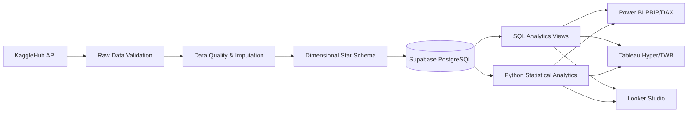

# OlistIQ — E-Commerce Intelligence & Business Analytics Platform

[](https://www.python.org/)
[](https://supabase.com/)
[](#dashboards)
[](tests/)

An enterprise-grade, portfolio business intelligence and analytics platform developed to analyze Brazilian e-commerce operations using the Olist dataset (~100k real-world marketplace transactions).

---

## 1. Business Problem & Objectives
Marketplaces operate in high-complexity environments with multi-seller fulfillment, regional logistics friction, and multi-tier payment instruments. This platform was architected to address:
* **Revenue Governance**: Accurately distinguishing Product Merchandise Value from Freight Collection to monitor true operational margins.
* **Customer Retention**: Quantifying buyer behavior and cohort retention in a predominantly acquisition-driven marketplace.
* **Logistics SLA Fulfillment**: Detecting carrier delays and state-level bottlenecks.
* **Customer Experience Correlation**: Measuring the statistical impact of delivery delays on customer satisfaction (CSAT).
* **Multi-BI Interoperability**: Delivering consistent, governed metrics across **Power BI**, **Tableau**, and **Google Looker Studio**.

---

## 2. End-to-End Architecture



---

## 3. Technology Stack

| Layer | Technology | Operational Function |
| :--- | :--- | :--- |
| **Ingestion** | `kagglehub` | Zero-configuration automated download of the Olist dataset |
| **Core Runtime** | Python 3.12+ (v3.14.6 ready) | Scripting, data pipelines, and CLI entry point |
| **Processing** | `pandas`, `numpy`, `pyarrow` | High-speed vectorized data transformation & parquet storage |
| **Database** | Supabase PostgreSQL | Central cloud warehouse (Star Schema, indexed, pooler enabled) |
| **Database Access** | `SQLAlchemy`, `psycopg` (v3) | Connection pooling, typed queries, and schema migrations |
| **Statistical Analytics**| `scipy`, `statsmodels`, `scikit-learn`| RFM segmentation, hypothesis testing, time series forecasting |
| **Power BI** | PBIP, DAX | Version-controlled project format, 25+ DAX measures, 6 report pages |
| **Tableau** | Hyper API, XML TWB | Standardized analytical extracts & native XML workbook |
| **Google Looker Studio** | PostgreSQL Connector / CSV Extracts| Governed cloud reporting specs & linking configurations |
| **Testing** | `pytest` | Automated reconciliation & mathematical integrity test suite |

---

## 4. Key Commercial Discoveries & Analytics Summary

| Metric | Empirical Finding | Business Impact |
| :--- | :--- | :--- |
| **Gross Merchandise Value (GMV)** | **R$ 15,737,667.52** | Baseline revenue throughput across 98,816 completed orders. |
| **Product Sales vs Freight** | R$ 13.49M Product / R$ 2.25M Freight | Freight charges constitute **14.3%** of total consumer outlay. |
| **Average Order Value (AOV)** | **R$ 159.26** | Consistent basket sizing across top Brazilian regions. |
| **Repeat Purchase Rate** | **3.06%** (2,924 repeat buyers) | Marketplace operates as an acquisition funnel; loyalty programs required. |
| **On-Time Delivery Rate** | **91.89%** (8.11% late deliveries) | Average delivery duration is 12.56 days; delays average +9.56 days beyond SLA. |
| **Average Review CSAT** | **4.09 / 5.0** | 76.8% Promoters (4-5 stars), 14.7% Detractors (1-2 stars). |
| **Late Delivery CSAT Penalty** | **-1.72 Stars Drop** | On-time orders average 4.22 CSAT; late orders plunge to 2.50 CSAT ($p < 0.001$). |
| **Top Forecasting Model** | **3-Month Moving Average** | Outperformed SARIMAX with test RMSE of R$ 72,802.46 (MAPE 6.78%). |

---

## 5. Storage Governance (Supabase Free-Tier Optimization)
* **1M Coordinate Aggregation**: Compressed `olist_geolocation_dataset.csv` from 1,000,163 raw pings down to **19,010 unique zip-code centroid points** (~1.8 MB), a **97% storage reduction**.
* **Total Database Footprint**: Strict PostgreSQL data types (`VARCHAR(32)`, `NUMERIC(10,2)`, `TIMESTAMP WITH TIME ZONE`) keep the entire database size at **~130 MB**, comfortably using **<27%** of Supabase's 500 MB free quota.

---

## 6. Quick Start & Execution

### 1. Setup Virtual Environment
```bash
python3 -m venv venv
source venv/bin/activate
pip install -r requirements.txt
```

### 2. Configure Environment Variables
```bash
cp .env.example .env
# Fill in your Supabase connection credentials
```

### 3. Run Complete End-to-End Pipeline
```bash
python main.py --stage all
```

### 4. Run Automated Reconciliation Tests
```bash
pytest tests/ -v
```

---

## 7. Dashboards & BI Assets
All three platforms mirror the **6 Governed Dashboard Pages** inspired by the modern Indigo/Slate design benchmark:
1. **Executive Overview**
2. **Sales Intelligence**
3. **Customer Intelligence (RFM & Cohorts)**
4. **Logistics Intelligence (SLA & Transit Times)**
5. **Product & Seller Intelligence**
6. **Customer Experience (CSAT & Sentiment)**

* **Power BI**: Open [`bi/powerbi/OlistIQ.pbip`](bi/powerbi/OlistIQ.pbip) directly in Power BI Desktop.
* **Tableau**: Open [`bi/tableau/OlistIQ_Analytics.twb`](bi/tableau/OlistIQ_Analytics.twb) in Tableau Desktop or Tableau Public.
* **Looker Studio**: Follow the step-by-step instructions in [`docs/looker_studio_guide.md`](docs/looker_studio_guide.md).

---

## 8. Documentation Index
- [System Architecture](docs/architecture.md)
- [Database Schema & ERD](docs/database_schema.md)
- [Data Dictionary](docs/data_dictionary.md)
- [Central KPI Dictionary](docs/kpi_definitions.md)
- [Executive Business Insights](docs/business_insights.md)
- [Power BI DAX Measures Catalog](docs/dax_measures_catalog.md)
- [Tableau Dashboard Specification](docs/tableau_dashboard_spec.md)
- [Looker Studio Deployment Guide](docs/looker_studio_guide.md)
- [Deployment & Setup Guide](docs/deployment_guide.md)

---

## 9. Limitations & Ethical Analytics Disclaimers
1. **Limited Historical Window**: The Olist public dataset covers September 2016 through September 2018. Time series models and projected customer lifetime values are directional estimates rather than deterministic multi-year predictions.
2. **Correlation vs Causation**: Delivery delays strongly correlate with lower CSAT scores ($-1.72$ star drop), but external factors (such as product defect rates or seller packaging quality) can act as confounding variables.
