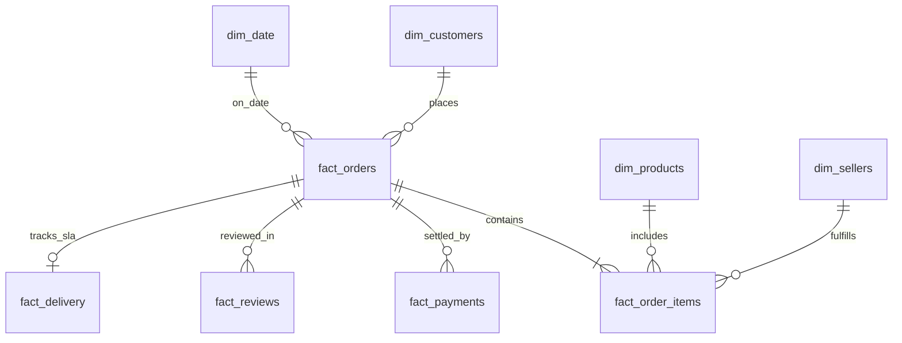

# OlistIQ — Relational Database Schema & Dimensional Modeling

## 1. Dimensional Star Schema Design

## 2. Table Catalog

### Dimensions
1. **`dim_customers`**: Unique customer mapping (`customer_id`, `customer_unique_id`, `city`, `state`, `zip_code_prefix`).
2. **`dim_products`**: Product metadata and English translated categories (`product_id`, `category_name_english`, `category_display_name`, physical dimensions).
3. **`dim_sellers`**: Merchant locations (`seller_id`, `city`, `state`, `zip_code_prefix`).
4. **`dim_geography`**: Aggregated zip code centroids (`zip_code_prefix`, `latitude`, `longitude`, `city`, `state`).
5. **`dim_date`**: Calendar dimension from 2016 to 2018 (`date_key`, `full_date`, `year`, `quarter`, `month`, `week_of_year`, `day_of_week`, `is_weekend`).
6. **`dim_payment_types`**: Payment method dictionary.

### Fact Tables (Respective Grains)
1. **`fact_orders`**: Grain: 1 record per order (`order_id`, `customer_id`, `order_status`, `order_purchase_timestamp`, `order_estimated_delivery_date`).
2. **`fact_order_items`**: Grain: 1 record per order item (`order_id`, `order_item_id`, `product_id`, `seller_id`, `price`, `freight_value`, `total_item_value`).
3. **`fact_payments`**: Grain: 1 record per payment transaction (`order_id`, `payment_sequential`, `payment_type`, `payment_installments`, `payment_value`).
4. **`fact_reviews`**: Grain: 1 record per review (`review_id`, `order_id`, `review_score`, `sentiment`).
5. **`fact_delivery`**: Grain: 1 record per delivered order (`order_id`, `delivery_duration_days`, `delivery_delay_days`, `is_on_time`, `is_late`).
